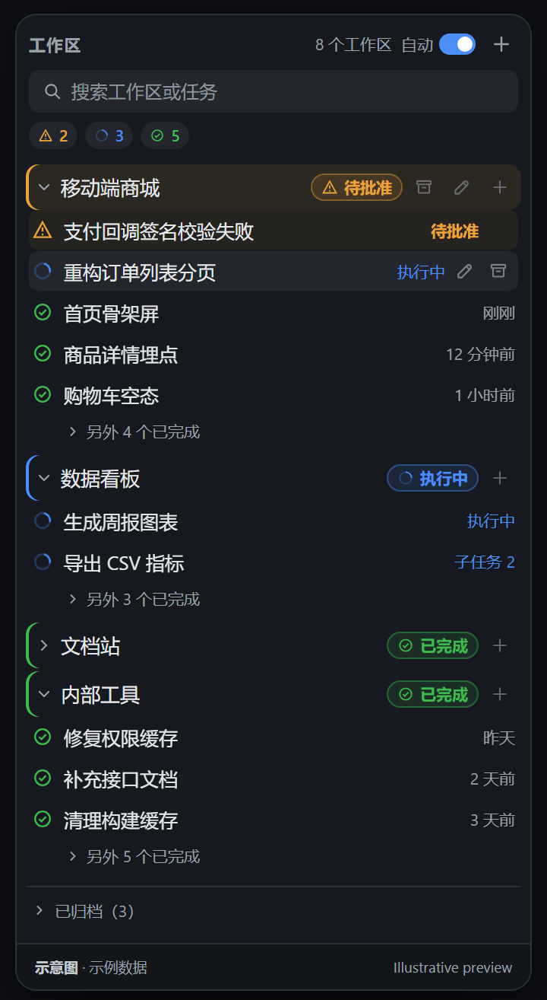

# dsh-workspace-status-board

> Status-first workspace board for the DSH sidebar. / 把 DSH 侧边栏工作区改成按状态优先排序的看板。

<p align="center">
  
</p>
<p align="center"><sub>示意图 · 示例数据（非真实会话截图） / Illustrative preview with sample data</sub></p>

[中文](#中文说明) · [English](#english-overview)

---

## 中文说明

### 用途

DSH 默认的侧边栏工作区列表按最近更新时间或手动顺序排列，工作区一多就不容易判断「现在该先看哪个」。这个插件把 `sidebar.workspaces` 区域替换成一块状态看板：

- **需要用户介入**的工作区排最前；
- **有任务正在执行**的工作区排第二；
- **已完成 / 空闲**的工作区排最后；
- 同一状态内按最近活动时间从新到旧排列。

排序、状态标识与相对时间都随 Host 的实时快照自动更新，不需要手动刷新。

### 主要功能

- **三种状态与醒目标识**：琥珀色三角感叹号（需介入）、品牌蓝旋转圆环（执行中）、绿色对勾（已完成）；工作区行、任务行和顶部汇总都使用同一套颜色与形状。
- **工作区行精简展示**：只显示工作区名称和状态标识，不显示任务数量、路径或最近活动时间；路径仍可用于搜索。
- **任务列表自动收起**：进行中的任务全部展示；已完成默认最多展示 3 条（搜索时同样适用），其余收在「另外 N 个已完成」后，可展开，也可再次收起。展开后「收起已完成」按钮位于已完成列表顶部；折叠工作区会重置为默认 3 条。展开状态只在本次页面生命周期内保留，刷新后恢复默认 3 条。
- **搜索**：按工作区名称、工作区路径、任务标题过滤；搜索期间分组自动展开，结果按显示的任务重新聚合状态并排序。
- **拖拽排序（仅关闭自动排序时）**：自动排序开启时严格按状态/时间排列，不显示拖拽手柄；关闭后冻结当前顺序并显示手柄，可拖拽微调冻结顺序。拖拽只允许在同一状态分组内，调整结果保存在 `auto-sort` 冻结快照中。
- **自动排序开关**：顶部「自动」开关默认开启，按「状态 → 时间」排序；关闭后冻结当前工作区与任务的完整顺序，归档会话、任务状态变化或新活动都不会再移动已有位置。冻结顺序保存在 localStorage，刷新后保持；关闭状态下可拖拽微调，重新开启开关即恢复自动排序并隐藏拖拽手柄。
- **启动更新检查**：每次启动读取 GitHub 仓库最新版本；发现高于当前安装版本时弹出全屏提示。点击「更新」会通过 pluginManager 安装最新 GitHub tarball，显示“正在更新”，成功后自动刷新页面；若安装要求重启则提示重启 DSH。也可选择「跳过此版本」或「不再提示更新」。跳过与不再提示记录在本地；若之后出现高于所跳过版本的新版本，会再次提示。
- **任务归档与恢复**：任务行悬停显示归档按钮。普通任务直接归档；仍有运行中工作时，Host 会拒绝静默归档，看板弹出「停止并归档」确认，确认后以 `stopActivity: true` 停止该会话的回合/子代理/后台工作并归档。已归档任务进入底部「已归档」区，可展开并恢复。
- **工作区归档与恢复**：工作区标题悬停显示归档按钮；归档只隐藏该工作区并保留其注册与会话，不写 Host。归档工作区进入底部「已归档工作区（N）」区，可随时恢复；归档期间不参与状态排序，也不出现在搜索结果中。
- **工作区重命名**：悬停工作区标题出现铅笔按钮；点击后在工作区下方展开内联编辑框，`Enter` 保存、`Escape` 取消，空白名称禁用保存。通过 Host 的 `workspaces.rename` 写入，成功后列表实时更新，失败显示错误条。
- **任务重命名**：任务行悬停出现铅笔按钮；点击后在该任务下方展开内联编辑框，`Enter` 保存、`Escape` 取消，空白标题禁用保存。通过 `sessions.using(..., reference.binding.session.rename(title))` 写入，成功后任务标题实时更新，失败显示错误条。
- **折叠轨道**：侧边栏收起为 56px 轨道时，显示三色状态计数，点击任一图标展开侧边栏。
- **新建与添加入口**：工作区标题悬停显示「＋」新建会话；顶部「＋」优先调用桌面原生目录选择器，当前环境没有原生能力时展开路径输入框，手动输入绝对目录路径。
- **中英双语**：所有可见文案走 DSH locale 服务，内置 `zh` / `en`。

### 三种状态如何判定

状态来自 `useSessionStatus` 的实时投影和 `useSessions` 摘要，工作区取组内最高优先级：

| 状态 | 判定 | 标识 |
| --- | --- | --- |
| **需要介入** `attention` | 会话存在待处理的 `pendingInteraction`：`approval`（等待批准）、`plan-review`（计划待确认）、`question`（等待回答）。 | 琥珀色 + 三角感叹号 + 浅色底；工作区行左侧色带与浅色底。 |
| **执行中** `running` | 没有待介入，且会话自身 `running`，或有正在运行的直接子代理（`subagentCatalog` 中 `running`）。 | 品牌蓝 + 旋转圆环（`prefers-reduced-motion` 时静止）。 |
| **已完成** `done` | 其余情况，包括空闲与有未读结果的会话。 | 绿色 + 对勾圆环。 |

归档会话、子代理会话、空白占位会话不参与状态聚合。

### 排序依据的时间字段

- 任务使用 `useSessions` 列表项的 **`updatedAt`**。Host 将其计算为 `max(session.createdAt, sessionListMetadata.lastPromptAt)`，即最近一次用户提示或 steer 的时间；代理输出不会刷新它。
- 工作区使用组内可见任务 `updatedAt` 的最大值；没有任务时回退到 `WorkspaceView.updatedAt`（ISO 字符串），再回退到 `createdAt`。
- 比较器：状态 rank（需介入 0 → 执行中 1 → 已完成 2）→ 活动时间降序 → 稳定键决胜。
- 手动拖拽后，同状态内手动位置优先；新出现且尚未手动排序的任务/工作区按时间排在手动项之前，避免新完成结果被「最多 3 条」遮住。

### 排序与标识的更新时机

- `useWorkspaces`：工作区注册、成员、归档集合变化时重排。
- `useSessions`：会话新建、摘要或 `updatedAt` 变化时重排。
- `useSessionStatus`：运行状态、待介入分类、未读完成状态变化时立即重排并切换标识。
- 组件内 30 秒定时器及页面重新可见事件只刷新「3 分钟前」这类相对时间文案；排序只在状态或时间字段变化时改变。

### 安装

要求：DSH Web / Desktop **0.2.2-rc.1 或更新版本**（需要 `sidebar.workspaces` 标准 Hook 与工作区归档接口）。

从 GitHub 安装到目标 profile（把 `<profile>` 换成实际 profile，例如 `desktop` 或 `web`）：

```sh
dsh plugin --profile <profile> add github:CYF736222347/dsh-workspace-status-board
```

也可以克隆本仓库后，在 DSH 插件管理中把仓库目录作为本地 bundle 安装。安装后刷新一次页面；之后排序、拖拽、归档都随事件实时更新。

本插件会以 `priority: -1` 覆盖原生 WorkspaceBrowser。禁用或移除插件后原生列表自动恢复，无需重启。**不要在同一个 profile 里同时保留开发副本和 GitHub 版本**：两者都注册在 `sidebar.workspaces` 的 `priority: -1`，单占位槽只允许一个同优先级占位者。

### 使用

1. 顶部「**自动**」开关：开启时按状态/时间自动排序；关闭后冻结当前工作区与任务顺序，归档或状态变化不再移动位置，可拖拽微调。
2. 顶部搜索框按工作区名、路径或任务标题过滤；`Escape` 或 × 清空。
3. 工作区标题点击展开/收起；任务行点击打开会话。
4. 关闭顶部「自动」开关后，拖动工作区标题左侧或任务行左侧的手柄，可微调冻结顺序；自动排序开启时不显示手柄。
5. 悬停工作区标题点击铅笔按钮，内联修改名称；`Enter` 保存、`Escape` 取消。
6. 悬停任务行点击铅笔按钮，内联修改任务标题；`Enter` 保存、`Escape` 取消。
7. 任务行悬停显示归档按钮；运行中的任务会先出现停止并归档确认。
8. 工作区标题悬停显示归档按钮；归档整组后可在底部「已归档工作区（N）」区恢复。
9. 底部「已归档（N）」区可展开，逐条恢复任务。
10. 工作区标题悬停「＋」新建会话；顶部「＋」添加工作区（原生选择器，或路径输入框）。
11. 启动时若发现新版本，会弹出更新提示；点击「更新」自动安装并刷新页面，失败时显示原因，也可通过提示中的 GitHub 仓库链接手动安装。

### 依赖与配置

- **运行时依赖**：无 npm 运行时依赖。React 18 由 DSH 浏览器模块表提供。
- **DSH 依赖**：`sidebar.workspaces` 的标准 Hook（`useWorkspaces` / `useSessions` / `useSessionStatus` / `usePanelInfo`）以及 `uiWorkspace`、`workspaces` 客户服务。
- **必需配置**：无。`package.json` 已声明 `dsh.bundle` 与 `dsh.client`，`cordis.patch.yml` 插入 id 为 `workspace-status-board` 的 Loader 行。
- **本地状态**：折叠、工作区归档、自动排序开关与冻结顺序保存在当前浏览器 localStorage：
  - `dsh.workspace-status-board.collapsed.v1`
  - `dsh.workspace-status-board.archived-workspaces.v1`
  - `dsh.workspace-status-board.auto-sort.v1`
  - `dsh.workspace-status-board.update.v1`
  已完成展开状态只在内存中保留，不跨刷新。旧版本的 `order.v1` 手动顺序键不再使用。
- **归档**：任务归档通过 Host 的 `workspaces.archiveSession` / `unarchiveSession`；工作区归档是浏览器本地隐藏，不调用 Host；**工作区重命名**通过 `workspaces.rename`；**任务重命名**通过 `sessions.using(..., reference.binding.session.rename(title))`；拖拽顺序不会写回 Host 工作区注册顺序。

### 已知取舍

看板覆盖原生浏览区，因此原生区域的消息内容全文搜索、置顶、归档筛选的三种模式、工作区删除菜单不在看板内；这些可通过禁用插件恢复。工作区与任务重命名均已提供；拖拽仅在自动排序关闭时可用，且只在同一状态内生效，顺序是浏览器本地的；触屏环境不保证 HTML5 拖拽可用。搜索期间「已归档」区暂时隐藏。

### 验证

- `client.js` / `index.js` 通过 `node --check`，CSS 括号平衡，中英文 locale 键集与 JSON 对齐。
- 纯逻辑测试覆盖：状态分组、同状态时间排序、自动排序冻结、冻结顺序持久化、拖拽仅在关闭自动排序时启用、已完成 3 条上限（含搜索）、工作区归档、任务归档与错误识别。
- 安装后通过 Slot 实时检查确认 `sidebar.workspaces` 的 `priority: -1` 占位者 active、原生 `priority: 0` inactive。
- 视觉渲染与真实拖拽手感需在页面刷新后人工确认。

### 版本更新

| 版本 | 更新内容 |
| --- | --- |
| **1.8.2** | 修复自动更新调用 `remote.pluginManager` 缺少注入导致的失败；更新弹窗不再因点击遮罩关闭，仅保留关闭按钮与 Esc。 |
| **1.8.1** | 修复 1.8.0 自动更新客户端因硬注入 `remote` 服务而未激活的问题：改回可选 `ctx.get('remote')` 查找，保留自动安装、进度和失败提示。 |
| **1.8.0** | 「更新」按钮改为真正安装：通过 pluginManager 安装最新 GitHub tarball，显示正在更新/失败原因，成功后自动刷新；需要重启时明确提示。 |
| **1.7.1** | 修复 web 工作区已完成列表偶发全部展开：清理旧 `expanded-done`/`order` 状态，折叠工作区时重置已完成展开，展开时在已完成列表顶部提供「收起已完成」按钮；重装以刷新旧客户端缓存。 |
| **1.7.0** | 每次启动检查 GitHub 仓库版本；发现新版本时弹出更新提示，支持更新、跳过此版本、不再提示更新；更新偏好保存在本地。 |
| **1.6.0** | 拖拽仅在关闭自动排序时启用；关闭后拖拽直接调整冻结顺序，开启自动排序时隐藏拖拽手柄；README 增加版本更新记录并更新示意图。 |
| **1.5.0** | 顶部新增「自动」排序开关；关闭时冻结工作区与任务顺序并持久化，归档会话或状态变化不再移动已有位置。 |
| **1.4.0** | 新增工作区归档/恢复（浏览器本地隐藏，不删除注册）；已完成任务在搜索时也最多显示 3 条，展开状态不再跨刷新持久化。 |
| **1.3.0** | 添加工作区改用桌面原生目录选择器；无原生能力时提供绝对路径输入；修复 browse/native 目录选择器组合导致的报错；README 增加效果示意图。 |
| **1.2.0** | 新增任务重命名：任务行悬停铅笔按钮，内联编辑，`Enter` 保存 / `Escape` 取消。 |
| **1.1.0** | 新增工作区重命名：工作区标题悬停铅笔按钮，内联编辑，`Enter` 保存 / `Escape` 取消。 |
| **1.0.0** | 首个版本：状态优先排序（需介入 → 执行中 → 已完成）、三态视觉标识、搜索、已完成 3 条折叠、任务归档/恢复、同状态拖拽、折叠轨道、三色计数、中英双语、添加工作区与新建会话。 |

发布新版本时，请同步更新 `package.json` 的 `version` 与 `client.js` 的 `PLUGIN_VERSION`，更新检查才能识别新版本。

### License

MIT。见 [LICENSE](LICENSE)。

---

## English overview

**Purpose.** Replace the DSH sidebar's workspace browsing region with a status-first board. Workspaces are ordered by needs-input, running, then done, and within each state by the latest human prompt/steer time (`updatedAt`). The three states have distinct color-and-shape markers, and the board updates live from the host's workspace, session, and status snapshots — no manual refresh.

**Main features.**

- Three status markers: amber triangle (needs input), blue spinner (running), green check (done).
- Workspace rows show only the name and status marker — no task count, path, or relative time; paths remain searchable.
- In-progress tasks are always shown; done tasks default to the 3 newest, in search results too, with the rest behind a “more done” toggle. Expansion is in-memory only and resets on reload.
- Search across workspace name, path, and task title; results re-aggregate status and order from displayed tasks.
- Drag reordering of workspaces and tasks **only when auto-sort is off**, within the same status group; dragging adjusts the frozen order. When auto-sort is on, the board follows state/time strictly and hides the drag handles.
- **Auto-sort switch** at the top, on by default: turning it off freezes the complete workspace and task order, so archiving a session or a status change no longer moves existing rows, and enables drag handles to fine-tune the frozen order. The frozen order survives reloads in localStorage; turning the switch back on resumes automatic sorting and hides the handles.
- **Startup update check**: on launch, reads the latest version from the GitHub repository and shows a modal when it is newer. Update installs the latest GitHub tarball through the plugin manager, shows progress and failure reasons, then reloads the page; a restart is reported when required. Skip this version and Don’t remind me again are stored locally; a newer version than the skipped one prompts again.
- Archive a task from its hover action. If work is still running, the host refuses a quiet archive and the board asks to stop and archive (`stopActivity: true`). Archived tasks move to a bottom “Archived” section with per-task restore.
- Archive a workspace from its hover action. This is a browser-local hide that keeps the registration and its sessions; archived workspaces move to a bottom “Archived workspaces” section with restore, and do not participate in sorting or search while archived.
- Rename a workspace from its hover pencil: an inline editor opens under the row, `Enter` saves, `Escape` cancels, and blank names cannot be saved. Renames go through the host's `workspaces.rename`; the list updates live and failures show an error notice.
- Rename a task from its hover pencil: the same inline editor appears under the task, with `Enter`/`Escape` and blank-title validation, using `sessions.using(..., reference.binding.session.rename(title))`; titles update live and failures show an error notice.
- Rail mode shows three status counts and expands the sidebar on click.
- Add-workspace (native desktop picker, with a manual path fallback) and new-session shortcuts, bilingual zh/en copy, and no configuration.

**Install.**

Requires DSH 0.2.2-rc.1 or newer.

```sh
dsh plugin --profile <profile> add github:CYF736222347/dsh-workspace-status-board
```

Refresh the page once after installation. The plugin shadows the shipped WorkspaceBrowser at `priority: -1`; disable or remove it to restore the native browsing region. Do not keep a development copy and the GitHub version in the same profile: both register at the same priority in a single-occupant slot.

**Dependencies and configuration.** No npm runtime dependencies; React 18 is supplied by the host. Uses the `sidebar.workspaces` standard hooks and the `uiWorkspace` / `workspaces` client services. No required configuration; `dsh.bundle` and `dsh.client` are declared in `package.json`, and `cordis.patch.yml` inserts the `workspace-status-board` loader row. Collapse, archived workspaces, the auto-sort switch plus its frozen order, and update-check preferences are stored in browser localStorage; done-task expansion is in-memory only.

**Known trade-offs.** Full-text message search, pinning, three-way archive filters, and the workspace delete menu from the native browser are not included; workspace rename is provided; workspace archive is a browser-local hide rather than a Host mutation; the auto-sort switch and frozen order are browser-local; drag is available only while auto-sort is off and is limited to one status group; touch drag is not guaranteed; archived workspaces and archived tasks are hidden while searching. Add-workspace uses the desktop native chooser when available and a manual absolute-path field otherwise, not the in-app browse dialog. The update check contacts GitHub’s API first and jsDelivr as a fallback once per startup unless reminders are disabled; Update installs the latest GitHub tarball through the plugin manager (via the ghproxy mirror), requires network access, and may request a DSH restart. Version history is listed under 版本更新 above.

**License.** MIT.
